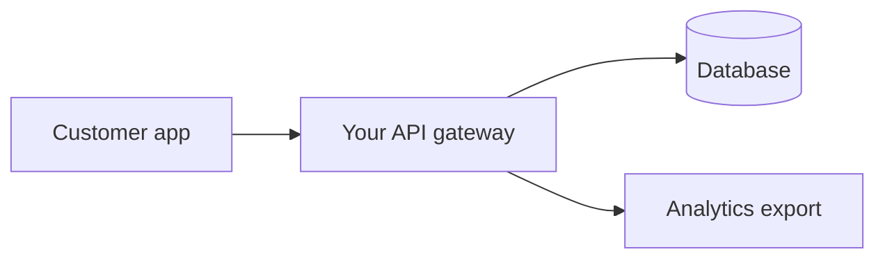

# Product Demos, Sales & Business Workflows

Product teams and sales teams lose time repeating the same demo, the same setup steps, and the same discovery questions. The plugNmeet AI Agent can run those conversations for you. It presents your slides, draws your architecture on a shared board, answers product questions from approved sources, runs short polls to qualify interest, and sends a structured summary to your CRM.

This guide describes four business workflows and gives you templates you can adapt. It is written for SaaS founders, product marketers, sales teams, support engineers, and corporate trainers.

:::info Under Active Development
The AI Agent engine and its APIs are under active development. Settings and behavior may change before general release. One-click UI integration for **Moodle, WordPress, and Joomla plugins** is planned once the feature is finalized and released. Until then, your engineering team configures rooms through the plugNmeet API.
:::

## How the Agent Fits a Sales or Support Call

Each visitor is placed in a private 1-on-1 room with the agent. The agent can:

- Present **PDF and Office slides** page by page on the whiteboard, with zoom and a **laser pointer** to highlight details.
- Draw **custom diagrams** with Mermaid syntax and shapes.
- Write **live checklists** into the shared notepad.
- Answer questions using **approved HTTPS pages** and **read-only external tools** (MCP servers) that you connect.
- Run **discovery polls and quizzes** and respond to each answer immediately.
- Produce an **`AI_AGENT_SESSION_SUMMARY`** artifact for your CRM.

The agent does not watch the visitor's webcam or screen. It works only with the whiteboard and the shared notepad, which keeps the conversation focused on the work you show together.

## Workflow 1: 24/7 Interactive Product Demo & Visual Sales Engineer

**Goal:** Let prospects explore your product any time, without booking a sales engineer.

**Setup:** Use the `OPEN_PER_USER` mode. Put the room link on your pricing page, in your documentation, or in your email follow-up. Each visitor gets a private session automatically. Set `max_concurrent_sessions` based on how many simultaneous demos your team can support.

**What the visitor experiences:**

1. The agent introduces itself and asks what the visitor wants to solve.
2. It opens your uploaded deck on the whiteboard and walks through the relevant slides.
3. It uses the **laser pointer** to highlight the feature being discussed.
4. It sketches the visitor's setup as a diagram. For example, a Mermaid flowchart of a visitor's current stack, with your product in the middle.
5. When the visitor asks a detailed question, the agent answers from your approved documentation pages or from a connected read-only knowledge tool.
6. It runs a short discovery poll such as "What is your team size?" or "Which feature matters most?" and reacts to the answers.

**Example Mermaid diagram the agent can draw:**



**Configuration highlights** (see the [Developer & API Guide](/docs/ai-agent/developer-guide) for full field names):

- `allow_web_fetch: true` with `allowed_knowledge_urls` listing your documentation prefixes.
- `mcp_servers` pointing to a read-only product catalogue or docs server, with `allowed_tools` restricted to read tools.
- `allow_polls: true` for discovery polls.
- `allow_whiteboard_write: true` so the agent can draw.

**Prompt template: Visual Sales Engineer**

```text
You are a product specialist for Acme Analytics. Your job is to help the visitor understand
whether Acme fits their team. Start by asking two questions about their current process.
Use the uploaded deck to walk through the three most relevant slides. Point at the feature with the laser pointer before you explain it.
When the visitor describes their stack, draw a simple diagram on the whiteboard with Mermaid.
Answer product questions only from the approved documentation. If you do not know, say so and offer to note the question in the shared notepad for the sales team.
Never discuss pricing details or promise delivery dates. Offer to connect the visitor with a human after the demo.
```

Suggested `topic`: `"Acme Analytics product demo"`. Suggested `forbidden_topics`: `["pricing negotiation", "competitor bashing", "legal terms"]`.

## Workflow 2: Interactive Documentation & Technical Onboarding Helper

**Goal:** Turn a setup call into a checklist and diagram the customer keeps.

**Setup:** Use `NORMAL_ROOM` so your onboarding engineer can open a 1-on-1 AI session from the Breakout Rooms panel, or use `OPEN_PER_USER` for self-service onboarding.

**What the agent does:**

- **Writes into the Shared Notepad.** It produces a checklist, such as "1. Create API key, 2. Set webhook URL, 3. Verify signature," and updates it block by block as the customer completes each step.
- **Sketches flows on the whiteboard.** It draws the authentication flow or data flow while it explains each step.
- **Fetches live docs.** When `allow_web_fetch` is enabled, it reads the exact documentation page that applies to the customer's question.

**Prompt template: Technical Onboarding Helper**

```text
You are a technical onboarding assistant for the Acme API. Guide the engineer through connecting their application.
Before each step, check the current checklist in the shared notepad. Write each completed step as a checked item.
Draw the request flow on the whiteboard before you explain the code.
When you need an exact parameter name or limit, fetch the approved documentation page and quote the relevant line.
Do not ask for API keys or secrets in the conversation. Tell the engineer to set them in their own environment.
Finish by writing a short "next steps" list in the notepad.
```

Suggested `topic`: `"Acme API onboarding: authentication, webhooks, and first request"`.

## Workflow 3: Employee Onboarding, Sales Pitch Coaching & Compliance Verification

**Goal:** Practise, test, and document understanding without scheduling a trainer for every session.

**Setup:** Use `CONTROLLED_USERS` with a roster of new hires or sales reps (up to 32 people per room). Each person gets a private 1-on-1 practice session.

**What the agent does:**

- **Coaches a pitch.** The learner practises the pitch out loud. The agent interrupts gently, asks for the value proposition, and writes the key phrases on the whiteboard.
- **Runs live quizzes.** A quiz such as "Which data fields are personal under our policy?" is answered on a phone or laptop. The agent reacts to each answer with feedback and an explanation.
- **Documents results.** The session summary includes quiz accuracy, concepts mastered, and concepts to review.

**Prompt template: Sales Pitch Coach**

```text
You are a sales coach for new account executives. Ask the rep to pitch Acme to a skeptical operations manager.
Listen to the pitch. Then give two specific strengths and one improvement, in under thirty seconds.
Use the whiteboard to write the rep's value statement in one sentence.
After the pitch, run a quiz with three questions about objection handling.
Stay on sales and product messaging. Do not give legal or financial advice.
```

**Prompt template: Compliance Verification**

```text
You are a compliance trainer. Teach the data-handling policy in short steps.
After each step, ask one question. Use a quiz to verify understanding.
Record concepts the learner has not mastered in the shared notepad.
If the learner scores below 80 percent, repeat the section and ask again.
```

:::tip Use Summaries for Records, Not Grades
Compliance and certification decisions should stay with your trainers. Use the summary as evidence of practice and a guide for follow-up.
:::

## Workflow 4: Lead Qualification & CRM Hand-off

**Goal:** Send every qualified conversation to your CRM with the context already filled in.

**How it works:**

1. The session ends, and the server writes an `AI_AGENT_SESSION_SUMMARY` artifact to the parent room.
2. Your backend receives the `artifact_created` webhook.
3. Your backend fetches the artifact with `/auth/artifact/fetch` and maps the fields to your CRM.
4. For a returning prospect, your backend passes the previous summary JSON, or its `continuation.previous_session_context_prompt` value, into the next session as `user_metadata.previous_session_context`. The agent continues from where the last conversation ended.

**Fields to map to CRM:**

| Summary field | Suggested CRM field |
| --- | --- |
| `user_info.name`, `user_info.ex_user_id` | Contact name and your external ID |
| `session.duration_seconds`, `session.turns_count` | Engagement score |
| `evaluation.concepts_mastered` / `struggled_with` | Interest areas and objections |
| `quiz_evaluation.accuracy_percent` | Qualification signal |
| `continuation.next_session_focus` | Next-step notes for the sales rep |
| `narrative_summary` | Short call note |
| `continuation.previous_session_context_prompt` | Ready-made context for the next session |

**Qualification prompt template**

```text
You are a product advisor. Ask about the visitor's team size, current tools, and the main problem they want to solve.
Run one discovery poll with options for team size. Use the answers to recommend the most relevant feature.
Do not promise pricing or contract terms. At the end, summarise the visitor's needs in the shared notepad as bullet points.
```

For full schema details, see [Summaries & Usage Artifacts](/docs/ai-agent/artifacts-and-billing). For continuity setup, see the [Developer & API Guide](/docs/ai-agent/developer-guide#multi-session-continuity-flow).

## Live Client Calls, Global Webinars & Host Copilot Workflows

The workflows above run as private 1-on-1 sessions. When a human sales rep, support engineer, or executive hosts a live group meeting or webinar, the same Insights framework provides three production workflows.

### 1. Cross-Border Sales & Multilingual Client Calls ([Live Captions, STT & Translation](/docs/ai-agent/speech-to-text-and-translation))

Run discovery calls, enterprise demos, or global town halls across language barriers with real-time STT subtitles, simultaneous spoken translation (neural TTS audio streams per target language), and live public chat translation. The host speaks once and every participant follows in their own language.

### 2. Host Copilot for Live Webinars & Customer Workshops ([In-Meeting AI Text Chat](/docs/ai-agent/ai-text-chat))

The host asks the AI Text Chat copilot to run room operations in real time: launch audience qualification polls, sketch system architecture diagrams on the whiteboard, write live action items into the shared notepad, set agenda countdown timers, manage recordings, or turn on live transcription and summarization on demand.

### 3. Automated Call Notes & Executive Briefs to CRM ([AI Meeting Summarization](/docs/ai-agent/meeting-summarization))

For human-led sales, legal, consulting, or support calls, enable `meeting_summarization_features` with a business `summarization_prompt`, for example: *"Summarize customer pain points, technical requirements, budget/timeline signals, decisions agreed, and next action items by owner."*

When the call ends, the server emits the `MEETING_SUMMARY` artifact through the `artifact_created` webhook. Your backend can attach the call summary directly to HubSpot, Salesforce, or your internal ticketing system, alongside the `SPEECH_TRANSCRIPTION` (`.vtt`) transcript.

## Choosing the Right Mode

| Goal | Recommended mode | Why |
| --- | --- | --- |
| Public product demo on your website | `OPEN_PER_USER` | Every visitor gets a session automatically, 24/7. |
| Onboarding a named customer | `NORMAL_ROOM` | Your engineer decides when to start the session. |
| Training a fixed group of staff | `CONTROLLED_USERS` | Only the listed people can start sessions. |

## Business Guardrails to Configure

- **Narrow the topic.** Use `topic`, `allowed_subtopics`, and `forbidden_topics` so the agent does not drift into unsupported areas.
- **Limit external tools.** Allow only the HTTPS domains you control, and only read-only MCP tools.
- **Set session limits.** Use `max_session_seconds` and `max_audio_minutes` to control cost per visitor.
- **Review the data flow.** Audio and text go to your AI provider. See the [Security Overview](/docs/security-overview).

## Related Pages

- [Overview & Concepts](/docs/ai-agent/overview)
- [Capabilities, Vision & Guardrails](/docs/ai-agent/tools-and-capabilities)
- [In-Meeting AI Text Chat](/docs/ai-agent/ai-text-chat)
- [Live Captions, STT & Translation](/docs/ai-agent/speech-to-text-and-translation)
- [AI Meeting Summarization](/docs/ai-agent/meeting-summarization)
- [Server & Provider Setup](/docs/ai-agent/configuration)
- [Summaries & Usage Artifacts](/docs/ai-agent/artifacts-and-billing)
