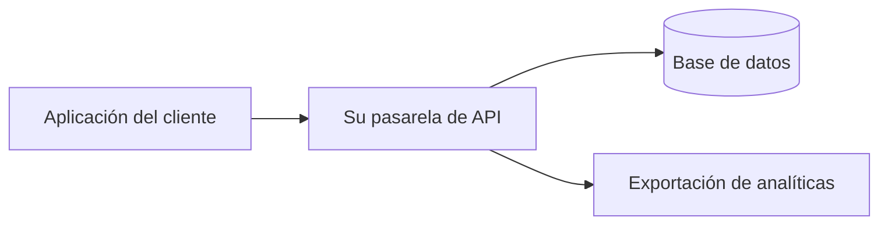

# Flujos de trabajo de demostración de producto, ventas y negocios

Los equipos de producto y de ventas pierden tiempo repitiendo la misma demostración, los mismos pasos de configuración y las mismas preguntas de descubrimiento. El Agente de IA de plugNmeet puede llevar esas conversaciones por usted. Presenta sus diapositivas, dibuja su arquitectura en una pizarra compartida, responde preguntas sobre el producto a partir de fuentes aprobadas, realiza encuestas breves para calificar el interés y envía un resumen estructurado a su CRM.

Esta guía describe cuatro flujos de trabajo empresariales y ofrece plantillas que puede adaptar. Está dirigida a fundadores de SaaS, responsables de marketing de producto, equipos comerciales, ingenieros de soporte y formadores corporativos.

:::info En desarrollo activo
El motor del Agente de IA y sus API están en desarrollo activo. La configuración y el comportamiento pueden cambiar antes de la publicación general. La integración con un solo clic en los plugins de **Moodle, WordPress y Joomla** está prevista para cuando la función esté terminada y publicada. Mientras tanto, su equipo de ingeniería configura las salas mediante la API de plugNmeet.
:::

## Cómo encaja el agente en una llamada de ventas o soporte

Cada visitante se coloca en una sala privada 1 a 1 con el agente. El agente puede:

- Presentar **diapositivas en PDF y Office** página por página en la pizarra, con zoom y un **puntero láser** para destacar detalles.
- Dibujar **diagramas personalizados** con la sintaxis de Mermaid y formas.
- Escribir **listas de verificación en vivo** en el bloc de notas compartido.
- Responder preguntas usando **páginas HTTPS aprobadas** y **herramientas externas de solo lectura** (servidores MCP) que usted conecte.
- Realizar **encuestas y cuestionarios de descubrimiento** y reaccionar de inmediato a cada respuesta.
- Generar un artefacto **`AI_AGENT_SESSION_SUMMARY`** para su CRM.

El agente no observa la cámara web ni la pantalla del visitante. Trabaja solo con la pizarra y el bloc de notas compartido, lo que mantiene la conversación centrada en el trabajo que ambos ven.

## Flujo de trabajo 1: demostración interactiva de producto disponible las 24 horas y, además, ingeniero de ventas visual

**Objetivo:** Permitir que los prospectos exploren su producto en cualquier momento, sin reservar un ingeniero de ventas.

**Configuración:** Use el modo `OPEN_PER_USER`. Coloque el enlace de la sala en su página de precios, en su documentación o en su seguimiento por correo electrónico. Cada visitante recibe automáticamente una sesión privada. Establezca `max_concurrent_sessions` según el número de demostraciones simultáneas que su equipo pueda atender.

**Qué vive el visitante:**

1. El agente se presenta y pregunta qué problema quiere resolver el visitante.
2. Abre en la pizarra la presentación que usted cargó y recorre las diapositivas más relevantes.
3. Usa el **puntero láser** para destacar la función que se está comentando.
4. Esboza la configuración del visitante como un diagrama. Por ejemplo, un diagrama de flujo Mermaid de la pila tecnológica actual del visitante, con su producto en el centro.
5. Cuando el visitante hace una pregunta detallada, el agente responde con su documentación aprobada o con una herramienta de conocimiento de solo lectura conectada.
6. Realiza una encuesta de descubrimiento breve, como «¿Cuántas personas hay en su equipo?» o «¿Qué función es la más importante para usted?», y reacciona a las respuestas.

**Ejemplo de diagrama Mermaid que puede dibujar el agente:**



**Aspectos clave de la configuración** (consulte la [Guía para desarrolladores y de la API](/docs/ai-agent/developer-guide) para ver los nombres completos de los campos):

- `allow_web_fetch: true` con `allowed_knowledge_urls` que enumere los prefijos de su documentación.
- `mcp_servers` que apunte a un catálogo de producto o a un servidor de documentación de solo lectura, con `allowed_tools` restringido a herramientas de lectura.
- `allow_polls: true` para las encuestas de descubrimiento.
- `allow_whiteboard_write: true` para que el agente pueda dibujar.

**Plantilla de prompt: ingeniero de ventas visual**

```text
You are a product specialist for Acme Analytics. Your job is to help the visitor understand
whether Acme fits their team. Start by asking two questions about their current process.
Use the uploaded deck to walk through the three most relevant slides. Point at the feature with the laser pointer before you explain it.
When the visitor describes their stack, draw a simple diagram on the whiteboard with Mermaid.
Answer product questions only from the approved documentation. If you do not know, say so and offer to note the question in the shared notepad for the sales team.
Never discuss pricing details or promise delivery dates. Offer to connect the visitor with a human after the demo.
```

Tema sugerido: `"Demostración de producto de Acme Analytics"`. `forbidden_topics` sugeridos: `["negociación de precios", "críticas a la competencia", "términos legales"]`.

## Flujo de trabajo 2: asistente de documentación interactiva y onboarding técnico

**Objetivo:** Convertir una llamada de configuración en una lista de verificación y un diagrama que el cliente pueda conservar.

**Configuración:** Use `NORMAL_ROOM` para que su ingeniero de onboarding pueda abrir una sesión de IA 1 a 1 desde el panel Breakout Rooms, o use `OPEN_PER_USER` para el onboarding de autoservicio.

**Lo que hace el agente:**

- **Escribe en el bloc de notas compartido.** Produce una lista de verificación, como «1. Crear clave de API, 2. Configurar la URL del webhook, 3. Verificar la firma», y la actualiza bloque a bloque a medida que el cliente completa cada paso.
- **Esboza flujos en la pizarra.** Dibuja el flujo de autenticación o el flujo de datos mientras explica cada paso.
- **Consulta documentación en directo.** Cuando `allow_web_fetch` está habilitado, lee la página de documentación exacta que corresponde a la pregunta del cliente.

**Plantilla de prompt: asistente de onboarding técnico**

```text
You are a technical onboarding assistant for the Acme API. Guide the engineer through connecting their application.
Before each step, check the current checklist in the shared notepad. Write each completed step as a checked item.
Draw the request flow on the whiteboard before you explain the code.
When you need an exact parameter name or limit, fetch the approved documentation page and quote the relevant line.
Do not ask for API keys or secrets in the conversation. Tell the engineer to set them in their own environment.
Finish by writing a short "next steps" list in the notepad.
```

Tema sugerido: `"Onboarding de la API de Acme: autenticación, webhooks y primera solicitud"`.

## Flujo de trabajo 3: onboarding de empleados, coaching de presentaciones de ventas y verificación de cumplimiento

**Objetivo:** Practicar, evaluar y documentar la comprensión sin asignar a un formador para cada sesión.

**Configuración:** Use `CONTROLLED_USERS` con una lista de nuevos empleados o comerciales (hasta 32 personas por sala). Cada persona recibe una sesión privada de práctica 1 a 1.

**Lo que hace el agente:**

- **Entrena la presentación.** El alumno practica su presentación en voz alta. El agente lo interrumpe con suavidad, pide la propuesta de valor y escribe las frases clave en la pizarra.
- **Realiza cuestionarios en directo.** Un cuestionario como «¿Qué campos de datos son personales según nuestra política?» se responde desde un teléfono o un portátil. El agente reacciona a cada respuesta con retroalimentación y una explicación.
- **Documenta los resultados.** El resumen de la sesión incluye la precisión en el cuestionario, los conceptos dominados y los conceptos que hay que repasar.

**Plantilla de prompt: coach de presentaciones de ventas**

```text
You are a sales coach for new account executives. Ask the rep to pitch Acme to a skeptical operations manager.
Listen to the pitch. Then give two specific strengths and one improvement, in under thirty seconds.
Use the whiteboard to write the rep's value statement in one sentence.
After the pitch, run a quiz with three questions about objection handling.
Stay on sales and product messaging. Do not give legal or financial advice.
```

**Plantilla de prompt: verificación de cumplimiento**

```text
You are a compliance trainer. Teach the data-handling policy in short steps.
After each step, ask one question. Use a quiz to verify understanding.
Record concepts the learner has not mastered in the shared notepad.
If the learner scores below 80 percent, repeat the section and ask again.
```

:::tip Use los resúmenes como registros, no como calificaciones
Las decisiones de cumplimiento y de certificación deben seguir en manos de sus formadores. Utilice el resumen como evidencia de la práctica y como guía para el seguimiento.
:::

## Flujo de trabajo 4: calificación de leads y envío de datos al CRM

**Objetivo:** Enviar cada conversación calificada a su CRM con el contexto ya completado.

**Cómo funciona:**

1. La sesión termina y el servidor escribe un artefacto `AI_AGENT_SESSION_SUMMARY` en la sala principal.
2. Su backend recibe el webhook `artifact_created`.
3. Su backend obtiene el artefacto con `/auth/artifact/fetch` y asigna los campos a su CRM.
4. En el caso de un prospecto que vuelve, su backend pasa el JSON del resumen anterior, o su valor `continuation.previous_session_context_prompt`, a la siguiente sesión como `user_metadata.previous_session_context`. El agente continúa desde donde terminó la conversación anterior.

**Campos que se asignan al CRM:**

| Campo del resumen | Campo sugerido en el CRM |
| --- | --- |
| `user_info.name`, `user_info.ex_user_id` | Nombre del contacto y su ID externo |
| `session.duration_seconds`, `session.turns_count` | Puntuación de participación |
| `evaluation.concepts_mastered` / `struggled_with` | Áreas de interés y objeciones |
| `quiz_evaluation.accuracy_percent` | Señal de calificación |
| `continuation.next_session_focus` | Notas de próximos pasos para el comercial |
| `narrative_summary` | Nota breve de la llamada |
| `continuation.previous_session_context_prompt` | Contexto listo para la siguiente sesión |

**Plantilla de prompt para la calificación**

```text
You are a product advisor. Ask about the visitor's team size, current tools, and the main problem they want to solve.
Run one discovery poll with options for team size. Use the answers to recommend the most relevant feature.
Do not promise pricing or contract terms. At the end, summarize the visitor's needs in the shared notepad as bullet points.
```

Para conocer el esquema completo, consulte [Resúmenes y artefactos de uso](/docs/ai-agent/artifacts-and-billing). Para configurar la continuidad, consulte la [Guía para desarrolladores y de la API](/docs/ai-agent/developer-guide#flujo-de-continuidad-entre-sesiones).

## Llamadas con clientes en vivo, webinars globales y flujos con copiloto para el anfitrión

Los flujos de trabajo anteriores se ejecutan como sesiones privadas 1 a 1. Cuando un comercial, un ingeniero de soporte o un directivo presenta una reunión grupal o un webinar en vivo, el mismo marco de Insights cubre tres flujos de producción adicionales.

### 1. Ventas internacionales y llamadas multilingües con clientes ([Subtítulos en vivo, STT y traducción](/docs/ai-agent/speech-to-text-and-translation))

Realice llamadas de descubrimiento, demostraciones para grandes cuentas o reuniones globales para toda la empresa sin barreras de idioma, con subtítulos STT en tiempo real, traducción hablada simultánea (flujos de audio TTS neuronales por cada idioma de destino) y traducción multilingüe del chat público. El anfitrión habla una sola vez y cada participante sigue la sesión en su propio idioma.

### 2. Copiloto para el anfitrión en webinars y talleres con clientes ([Chat de IA en la reunión](/docs/ai-agent/ai-text-chat))

El anfitrión pide al copiloto de Chat de IA que gestione la sala en tiempo real: lanzar encuestas de calificación del público, dibujar diagramas de arquitectura del sistema en la pizarra, escribir puntos de acción en el bloc de notas compartido, fijar temporizadores para la agenda, gestionar las grabaciones o activar la transcripción y el resumen en vivo cuando lo necesite.

### 3. Notas automáticas de llamadas e informes ejecutivos al CRM ([Resumen de reuniones con IA](/docs/ai-agent/meeting-summarization))

En llamadas de ventas, legales, de consultoría o de soporte dirigidas por personas, active `meeting_summarization_features` con un `summarization_prompt` empresarial, por ejemplo: *«Resuma los puntos de dolor del cliente, los requisitos técnicos, las señales de presupuesto y plazo, las decisiones acordadas y las próximas acciones con su responsable.»*

Cuando termina la llamada, el servidor emite el artefacto `MEETING_SUMMARY` mediante el webhook `artifact_created`. Su backend puede adjuntar el resumen de la llamada directamente a HubSpot, Salesforce o su sistema interno de tickets, junto con la transcripción `SPEECH_TRANSCRIPTION` (`.vtt`).

## Cómo elegir el modo adecuado

| Objetivo | Modo recomendado | Motivo |
| --- | --- | --- |
| Demostración pública de producto en su sitio web | `OPEN_PER_USER` | Cada visitante recibe una sesión automáticamente, las 24 horas. |
| Onboarding de un cliente identificado | `NORMAL_ROOM` | Su ingeniero decide cuándo iniciar la sesión. |
| Formación de un grupo fijo de personal | `CONTROLLED_USERS` | Solo las personas de la lista pueden iniciar sesiones. |

## Salvaguardas empresariales que debe configurar

- **Acote el tema.** Use `topic`, `allowed_subtopics` y `forbidden_topics` para que el agente no se desvíe hacia áreas no respaldadas.
- **Limite las herramientas externas.** Permita solo los dominios HTTPS que usted controla y solo herramientas MCP de lectura.
- **Establezca límites de sesión.** Use `max_session_seconds` y `max_audio_minutes` para controlar el costo por visitante.
- **Revise el flujo de datos.** El audio y el texto se envían a su proveedor de IA. Consulte el [Resumen de seguridad](/docs/security-overview).

## Páginas relacionadas

- [Descripción general e Insights](/docs/ai-agent/overview)
- [Capacidades y límites del agente](/docs/ai-agent/tools-and-capabilities)
- [Chat de IA en la reunión](/docs/ai-agent/ai-text-chat): copiloto para moderadores con herramientas de gestión de sala.
- [Resumen de reuniones con IA](/docs/ai-agent/meeting-summarization): actas automáticas para llamadas de ventas y onboarding.
- [Subtítulos en vivo, STT y traducción](/docs/ai-agent/speech-to-text-and-translation): subtítulos, traducción hablada y transcripciones para llamadas y webinars multilingües.
- [Configuración del servidor y proveedores](/docs/ai-agent/configuration)
- [Resúmenes y artefactos de uso](/docs/ai-agent/artifacts-and-billing)
