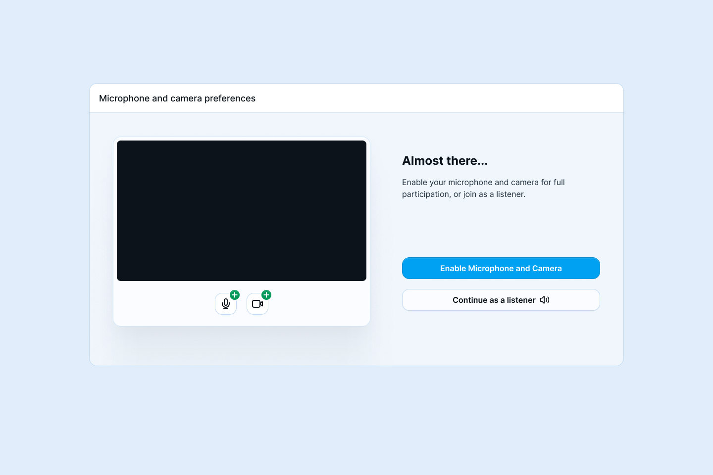
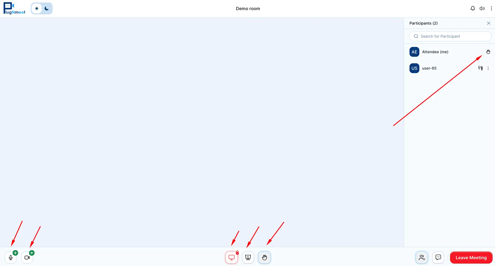
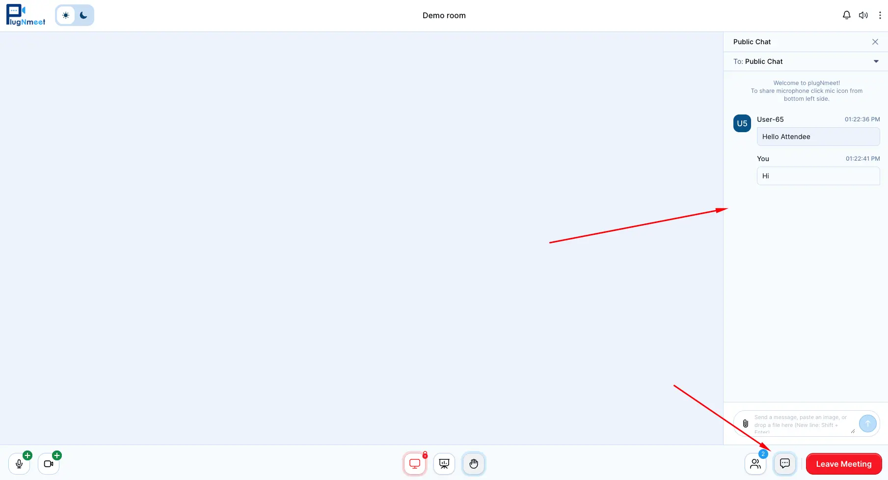
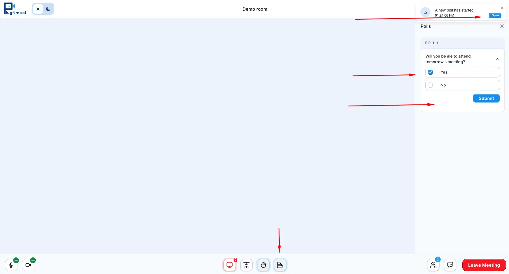
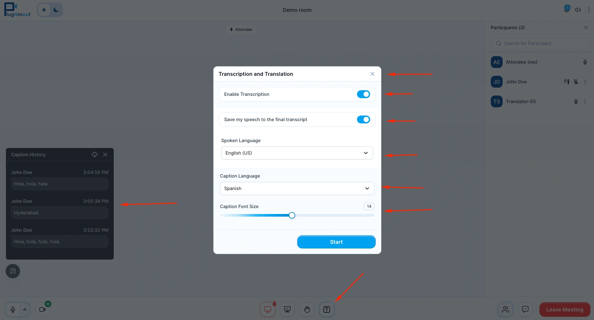
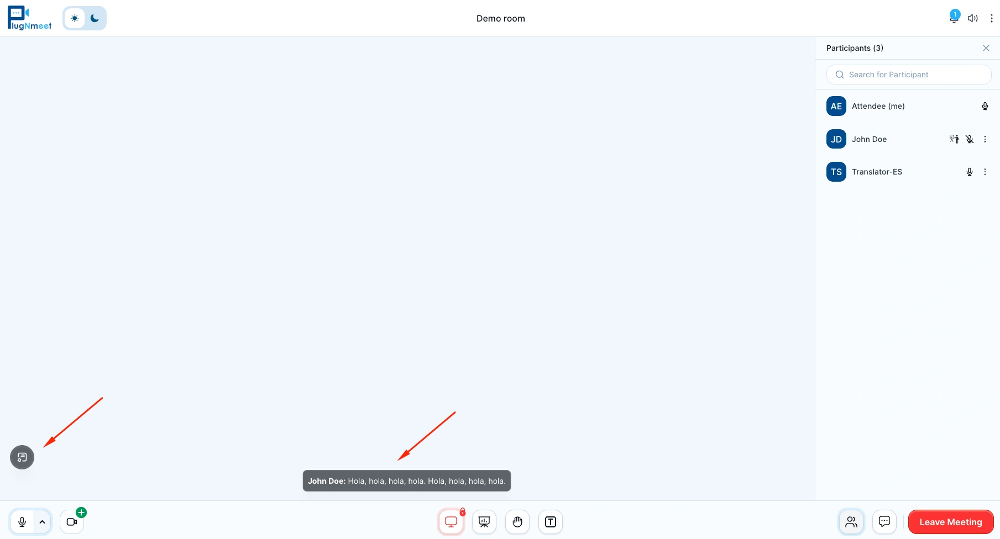
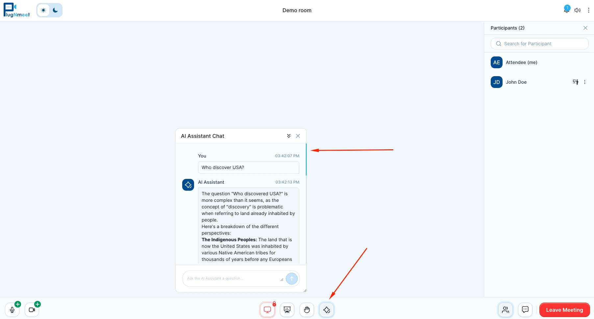
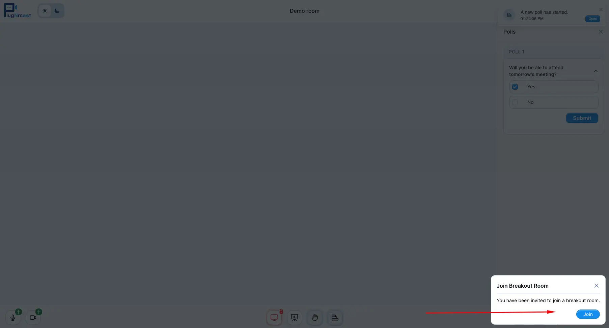
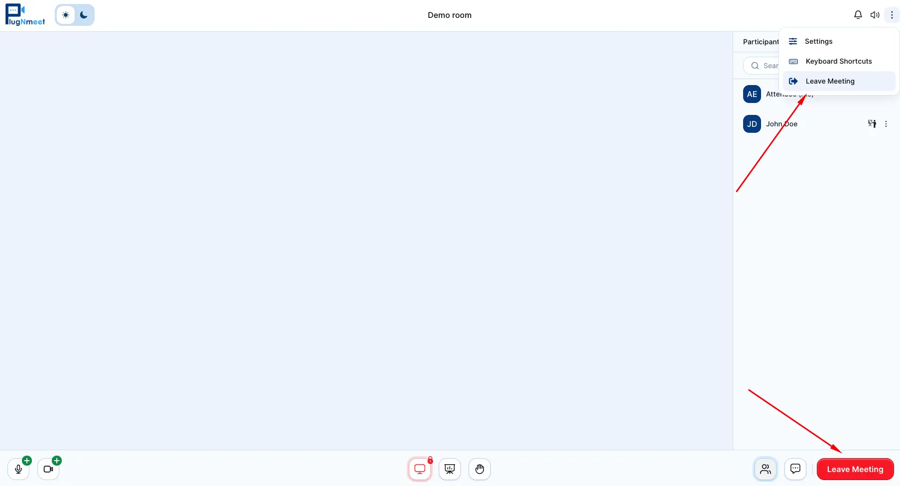

# Guía del asistente: Cómo unirse y participar en una reunión

¡Le damos la bienvenida a la Guía del Asistente! Este documento le guiará a través de todo lo que necesita saber para unirse y participar con éxito en una videoconferencia de plugNmeet.

---

## Primeros pasos: Unirse a una reunión

Cuando acceda por primera vez a una sala de PlugNmeet, se le solicitará que elija cómo desea unirse a la sesión de audio. Este es el paso inicial más importante.

-   **Habilitar Micrófono y Cámara:** Seleccione esta opción para hablar y compartir su video en la reunión. Su navegador le solicitará permiso para acceder a su micrófono y cámara.
-   **Continuar como oyente:** Elija esta opción para unirse sin micrófono ni cámara. Podrá escuchar todo, pero no podrá hablar ni compartir video.

**Importante:** Esta elección no es permanente. Si decide **Continuar como oyente**, podrá activar su micrófono y cámara más tarde desde la barra de control principal (siempre que el moderador lo permita).

---

## Sección 1: La barra de control del asistente

Estos son los controles básicos que utilizará durante la reunión, ubicados en la parte inferior de la pantalla.

-   **Micrófono:** Haga clic en este icono para silenciar o activar su sonido.
-   **Cámara web:** Haga clic en este icono para iniciar o detener el uso compartido de su cámara web. Puede elegir un fondo virtual antes de comenzar a compartir.
-   **Levantar la Mano:** Haga clic en este icono para indicar al moderador que tiene una pregunta o desea intervenir.

---

## Sección 2: Participar en la reunión

Estas funciones le permiten interactuar con el moderador y los demás participantes.

### Uso del chat

-   **Chat Público:** Haga clic en el icono de **Chat** para abrir el panel de chat principal, donde podrá enviar mensajes a todos los asistentes.
-   **Chat Privado:** Para enviar un mensaje privado, abra la lista de **Participantes**, haga clic en el menú de tres puntos junto al nombre de un usuario y seleccione **Enviar mensaje privado**.

### Ver la lista de participantes

-   Haga clic en el icono de **Participantes** para ver una lista de todas las personas que se encuentran actualmente en la reunión.

### Responder a las encuestas

-   Si el moderador inicia una encuesta, recibirá una notificación. Puede abrir la pestaña de **Encuestas** en el panel de participantes para emitir su voto.

### Transcripción y traducción
- **Iniciar Transcripción y Traducción:** Haga clic en el icono de **Transcripción y Traducción** en la barra de control principal inferior para iniciar el servicio (si el moderador lo ha habilitado para usted).

- **Historial:** Puede ver la **Transcripción y Traducción en Vivo** en tiempo real. Haga clic en el icono de **Historial** para consultar el historial completo de la transcripción.

**Importante:** Es necesario **Habilitar el Micrófono** para utilizar la **Transcripción y Traducción**.

### Uso del asistente de IA

- **Habilitar/Deshabilitar:** Haga clic en el icono del **Asistente de IA** en la barra de control principal inferior para iniciar el Asistente de IA (si el moderador lo ha habilitado para usted).

#### Agente de IA de voz y pizarra 1 a 1

Algunas salas ofrecen un agente de IA individual para el aprendizaje o para explorar productos. Usted conversa con él, y puede dibujar en la pizarra, escribir notas en el bloc de notas compartido y hacerle breves preguntas de cuestionario.

- **Su sesión privada:** Es posible que se le asigne una sala de grupo propia, con el nombre `<Su Nombre> (Sesión de IA)`, cuando la sala esté configurada para ello. La sala principal funciona como sala de espera hasta que comience su sesión.
- **Hable con naturalidad:** Puede interrumpir al agente mientras habla. Se detendrá y le escuchará.
- **Barra de estado:** La barra de estado de IA muestra lo que hace el agente, como **Escuchando**, **Hablando**, **Dibujando** o **En pausa**.
- **Responder cuestionarios:** Cuando el agente realice un cuestionario, envíe su respuesta en la encuesta. Recibirá comentarios de inmediato.
- **Cámara web y compartición de pantalla:** El agente no observa su cámara web ni su pantalla. Solo ve la pizarra y el bloc de notas compartido.

Para saber más sobre el funcionamiento de las sesiones de IA, consulte [Educación y profesor virtual](/docs/ai-agent/educator-guide) y [Demostraciones de producto, ventas y negocios](/docs/ai-agent/business-and-use-cases).

:::info En Desarrollo Activo
El Agente de IA está en desarrollo activo, y los controles con un solo clic en los plugins de Moodle, WordPress y Joomla están previstos para una versión futura.
:::

---

## Sección 3: Visualización de contenido

El moderador puede compartir diversos tipos de contenido durante la reunión.

-   **Ver una Pantalla Compartida:** Si el moderador comparte su pantalla, esta aparecerá automáticamente en el área principal de la interfaz.
-   **Interactuar con la Pizarra:** Si el moderador activa la pizarra, podrá ver lo que se está dibujando. También es posible que le otorguen permisos para dibujar usted mismo en ella.
-   **Ver un Video Compartido:** Si el moderador comparte un video, este aparecerá en su pantalla con controles de reproducción.

---

## Sección 4: Salas de grupo (Breakout Rooms)

El moderador puede dividir la sesión principal en salas más pequeñas para realizar actividades grupales.

-   Si se le asigna a una sala, verá una notificación invitándole a **Unirse**.
-   Se le redirigirá a una nueva sala de reuniones de menor tamaño. Al finalizar la sesión de grupos, volverá automáticamente a la sala principal.

---

## Sección 5: Salir de la reunión

- **Salir de la Reunión:** Si selecciona **Salir de la Reunión** en el menú superior derecho o en el botón inferior derecho, abandonará la sesión, pero esta permanecerá activa para los demás participantes.

